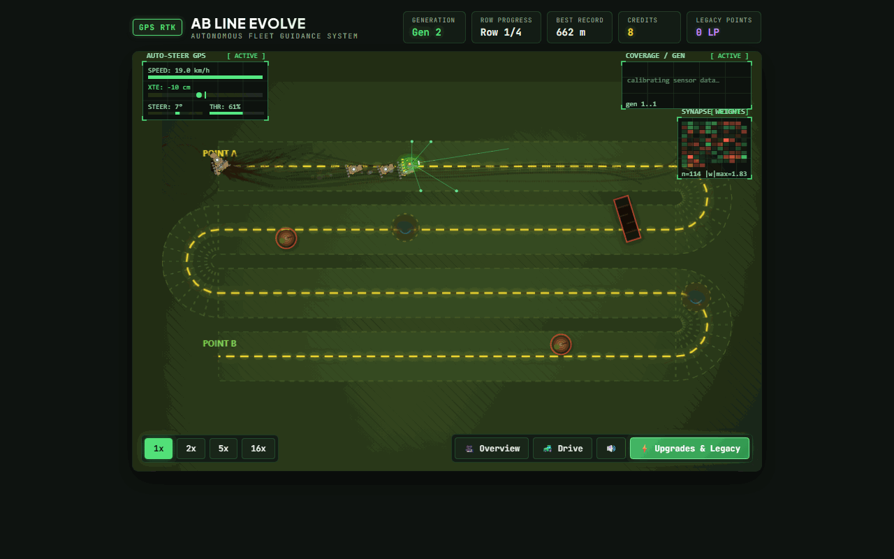

# AB Line Evolve



A browser idle game about a neuroevolution experiment. A fleet of simulated
tractors learns to follow a guidance line along the rows of a paddock, turn at
the headland and avoid hazards. Each generation keeps the best driver and
mutates it. There is no gradient descent and no training data. You spend credits
on upgrades, watch the best driver, or take the wheel yourself.

State: playable locally with the steps below. A hosted build is being refreshed, so there is no play link here yet.

## Run it

Needs Node 22.7 or newer.

```bash
npm install
npm run dev      # dev server (Vite)
npm test         # headless simulation tests
npm run build    # static build into dist/
```

## How it works

- `src/sim/` is the pure, headless simulation (no DOM), so offline progress can replay it.
- `src/game/` and `src/ui/` hold the Canvas2D rendering and the interface.
- TypeScript and Vite, no framework.

Built with Claude Code and Codex as pair tools; design, decisions and testing are mine.

## License

MIT. See [LICENSE](LICENSE).
